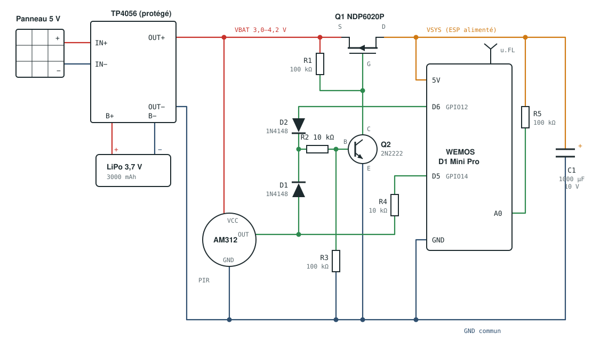

# 📬 iMailBox

🇬🇧 [English version](README.md)

Boîte aux lettres connectée autonome : un capteur de mouvement détecte l'arrivée du courrier et envoie une notification Discord, avec l'état de la batterie.

Le montage ne consomme presque rien au repos (environ 20 µA) : l'ESP8266 est **complètement coupé** et ne s'allume que lorsque le capteur détecte quelque chose. Une batterie LiPo rechargée par un petit panneau solaire suffit donc.

## Fonctionnement

1. Au repos, seul le capteur PIR (AM312) est alimenté.
2. Le PIR détecte un mouvement : un transistor NPN commande un MOSFET canal P, qui alimente le D1 Mini Pro.
3. L'ESP met immédiatement **D6 à HIGH** pour garder son alimentation (auto-maintien), car le PIR ne reste à HIGH que quelques secondes.
4. Il mesure la batterie, se connecte au Wi-Fi, récupère l'heure (NTP) et envoie la notification Discord.
5. Il met **D6 à LOW** : l'alimentation est coupée.

Une notification au maximum est envoyée toutes les 5 minutes (anti-spam). L'heure du dernier envoi et les statistiques sont enregistrées dans la flash (LittleFS), donc elles survivent aux coupures d'alimentation.

### Exemple de notification

```
📬 Boîte aux lettres
Du courrier vient d'arriver !

🔋 Batterie    ████████░░ 78 %
               3,98 V (+12 mV)
📶 Wi-Fi       -67 dBm, connexion 2340 ms
📊 Activité    42 réveils, 38 notifs, 1 échec
🗓️ En service  27 jours
```

La couleur de la carte Discord suit la batterie : vert au-dessus de 50 %, orange de 21 à 50 %, rouge à 20 % et moins (avec un message d'alerte).

## Matériel

| Repère | Composant | Rôle |
|---|---|---|
| | WEMOS D1 Mini Pro (ESP8266) + antenne 2,4 GHz u.FL | Microcontrôleur et Wi-Fi |
| | Capteur PIR AM312 | Détection du courrier |
| | LiPo 3,7 V 3000 mAh | Batterie |
| | TP4056 **avec protection** (DW01 + 8205A) | Charge et protection de la batterie |
| | Panneau solaire 5 V, 1 à 2 W | Recharge |
| Q1 | NDP6020P (MOSFET canal P, TO-220) | Interrupteur d'alimentation |
| Q2 | 2N2222 (NPN, TO-92) | Commande de Q1 |
| D1, D2 | 1N4148 | « OU » entre le PIR et D6 |
| R1, R3, R5 | 100 kΩ | Rappel de grille, rappel de base, mesure de la batterie |
| R2, R4 | 10 kΩ | Courant de base, protection de D5 |
| C1 | 1000 µF 10 V électrolytique | Absorbe les pics du Wi-Fi |

## Câblage



Version texte :

```
Panneau 5V ──► TP4056 IN+/IN−
LiPo ────────► TP4056 B+/B−

TP4056 OUT+ (VBAT) ──┬──► AM312 VCC
                     ├──► R1 100k ──► grille Q1
                     └──► Source Q1

Drain Q1 (VSYS) ──┬──► D1 Mini 5V
                  ├──► C1 + (C1 − au GND)
                  └──► R5 100k ──► A0

Grille Q1 ──► Collecteur Q2,  Émetteur Q2 ──► GND
Base Q2 ◄── R2 10k ◄──┬── D1 ◄── AM312 OUT
                      └── D2 ◄── D6 (GPIO12)
Base Q2 ── R3 100k ──► GND

AM312 OUT ── R4 10k ──► D5 (GPIO14)
Toutes les masses reliées ensemble (TP4056 OUT−, AM312, D1 Mini, C1)
```

| Broche D1 Mini | GPIO | Usage |
|---|---|---|
| D5 | 14 | Lecture du PIR |
| D6 | 12 | Auto-maintien de l'alimentation |
| A0 | | Tension de la batterie |
| 5V | | Alimentation (VSYS) |

### Points d'attention

- **Antenne externe** : sur le D1 Mini Pro, il faut déplacer la résistance 0 Ω située près de l'antenne céramique pour activer le connecteur u.FL.
- **Brochages** : NDP6020P vu de face = `G D S` (languette reliée au Drain). 2N2222 en TO-92, face plate vers soi = généralement `E B C`, mais certains modèles (P2N2222A) sont inversés. Vérifier la fiche technique.
- **Sens des composants** : la bande des diodes est côté R2, la patte « − » de C1 va au GND.
- **Batterie** : souder un fil à la fois et isoler aussitôt, pour éviter tout court-circuit.

## Installation

### Prérequis

- VS Code avec l'extension **PlatformIO**
- Optionnel : l'extension **Wokwi Simulator** pour tester sans matériel

### Configuration

Copier le fichier d'exemple et le remplir :

```sh
cp include/secrets.h.example include/secrets.h
```

```cpp
#define WIFI_SSID "MonWiFi"
#define WIFI_PASSWORD "MonMotDePasse"
#define DISCORD_WEBHOOK_URL "https://discord.com/api/webhooks/XXXX/YYYY"
```

`include/secrets.h` est ignoré par git. Le webhook se crée dans Discord : *Paramètres du salon → Intégrations → Webhooks*.

### Compiler et téléverser

```sh
pio run -e d1_mini_pro -t upload
pio device monitor
```

Pendant le développement en USB, l'alimentation n'est pas coupée : le programme passe alors dans `loop()` et réagit à chaque nouvelle détection.

### Réglages

Dans [src/main.cpp](src/main.cpp) :

| Constante | Défaut | Rôle |
|---|---|---|
| `COOLDOWN_S` | 300 s | Délai minimum entre deux notifications |
| `LOW_BATTERY_PERCENT` | 20 % | Seuil d'alerte de batterie faible |
| `WIFI_TIMEOUT_MS` | 15 s | Abandon de la connexion Wi-Fi |
| `ADC_FULL_SCALE_V` | 4,2 V | Calibration de la mesure de la batterie |

**Calibration de la batterie** : mesurer la tension de la batterie au multimètre, la comparer à la valeur affichée sur Discord, puis ajuster `ADC_FULL_SCALE_V` proportionnellement.

## Simulation (Wokwi)

Wokwi ne simule pas l'ESP8266 : l'environnement `wokwi` compile le même code pour un **ESP32** (les `#ifdef ESP32` gèrent les différences).

```sh
pio run -e wokwi
```

Puis, dans VS Code : *Wokwi: Start Simulator*.

| Élément du schéma | Simule |
|---|---|
| PIR sur GPIO14 | Le capteur (cliquer dessus pour déclencher) |
| LED « HOLD » sur GPIO13 | L'auto-maintien de l'alimentation |
| Potentiomètre sur GPIO34 | La tension de la batterie (0 à 4,2 V) |

Limites :
- Wokwi ne simule que la logique : la coupure d'alimentation, le MOSFET, les diodes et la charge ne sont pas simulés. Pour le circuit d'alimentation, utiliser [Falstad CircuitJS](https://www.falstad.com/circuit/) ou LTspice.
- La flash simulée est remise à zéro à chaque redémarrage : les statistiques repartent de 0.
- Le réseau simulé peut couper certaines connexions HTTPS. Le code fait 3 tentatives d'envoi.

Le script [scripts/merge_bin.py](scripts/merge_bin.py) génère une image flash complète (`firmware_merged.bin`), sans laquelle LittleFS n'est pas disponible dans Wokwi.

## Structure du projet

```
├── docs/
│   └── schematic.svg       # schéma électrique
├── include/
│   ├── secrets.h.example   # modèle de configuration
│   └── secrets.h           # identifiants (ignoré par git)
├── scripts/
│   └── merge_bin.py        # image flash complète pour Wokwi
├── src/
│   └── main.cpp            # programme
├── diagram.json            # schéma Wokwi
├── wokwi.toml              # configuration Wokwi
└── platformio.ini          # environnements d1_mini_pro et wokwi
```

## Statistiques enregistrées

Le fichier `/stats` de la flash contient une structure de taille fixe (environ 40 octets), réécrite à chaque réveil : il ne grossit jamais.

| Champ | Contenu |
|---|---|
| `lastSent` | Heure du dernier envoi réussi (anti-spam) |
| `wakeups` | Nombre de réveils |
| `sent` | Notifications envoyées |
| `failures` | Échecs Wi-Fi ou HTTP |
| `firstBoot` | Date de mise en service |
| `lastVoltage` | Tension au réveil précédent |

Pour tout remettre à zéro : `pio run -e d1_mini_pro -t erase`, puis téléverser à nouveau le programme (`erase` efface aussi le programme).
